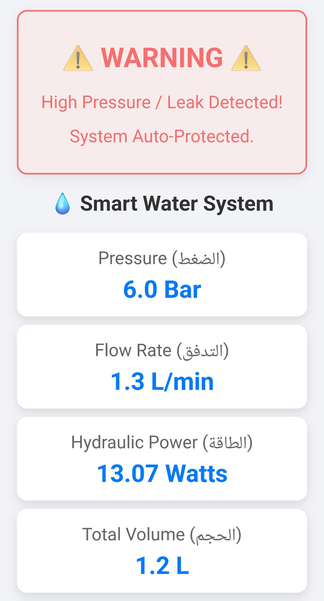
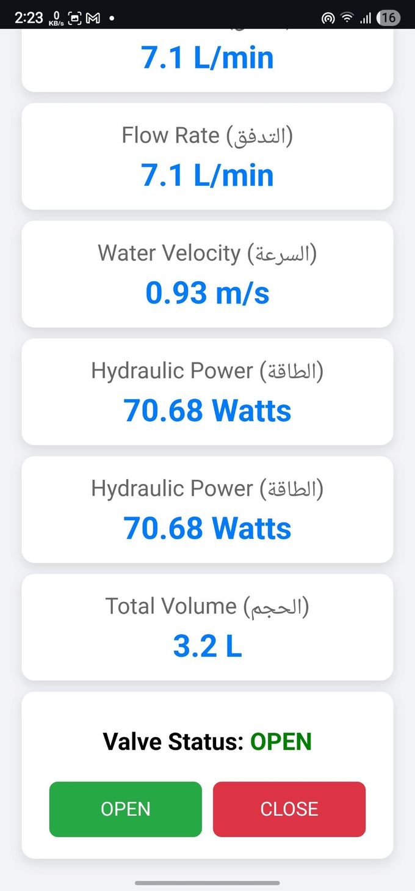
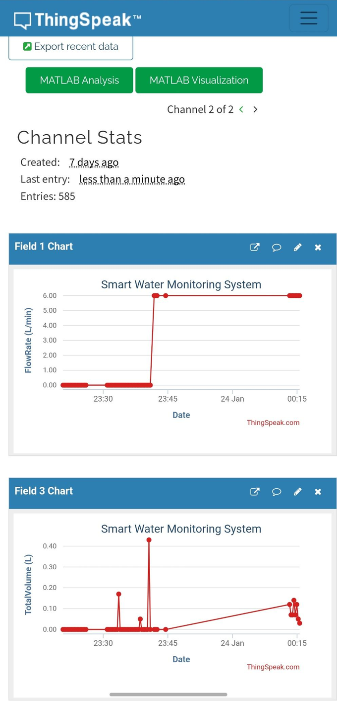
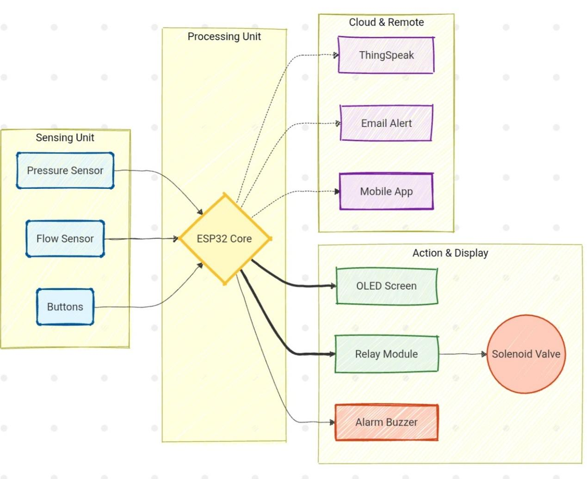
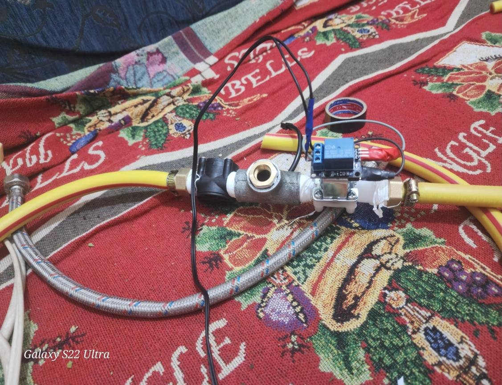
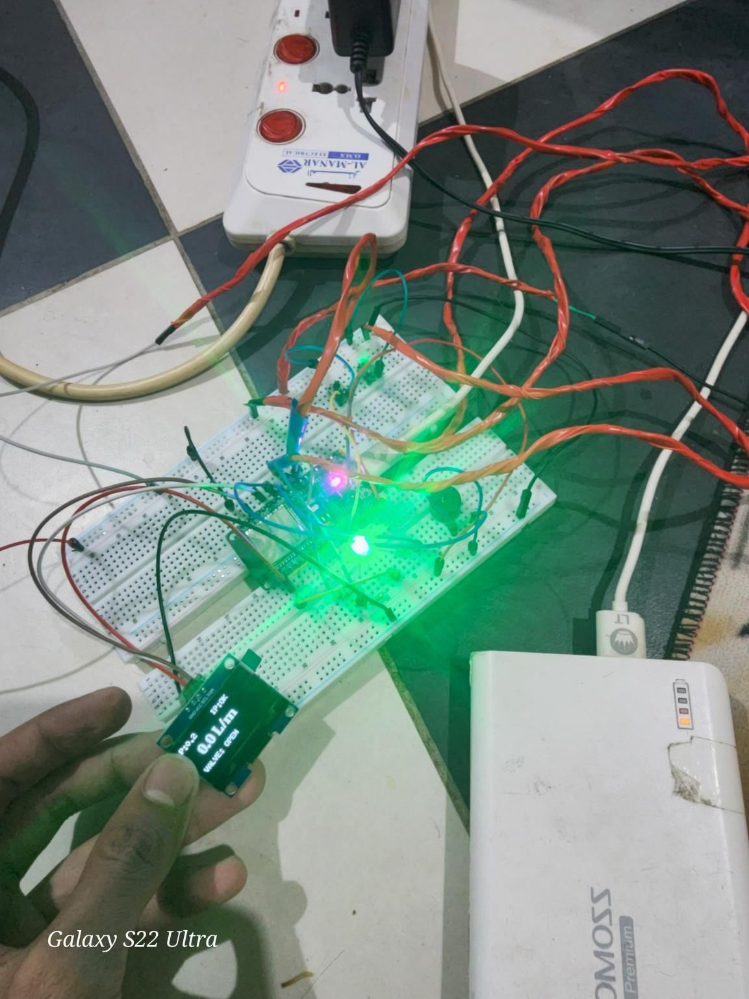
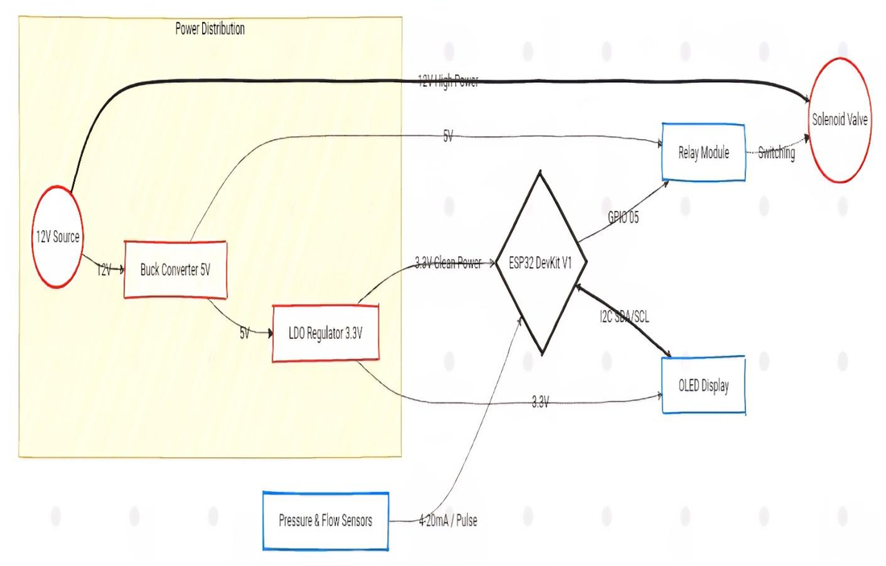
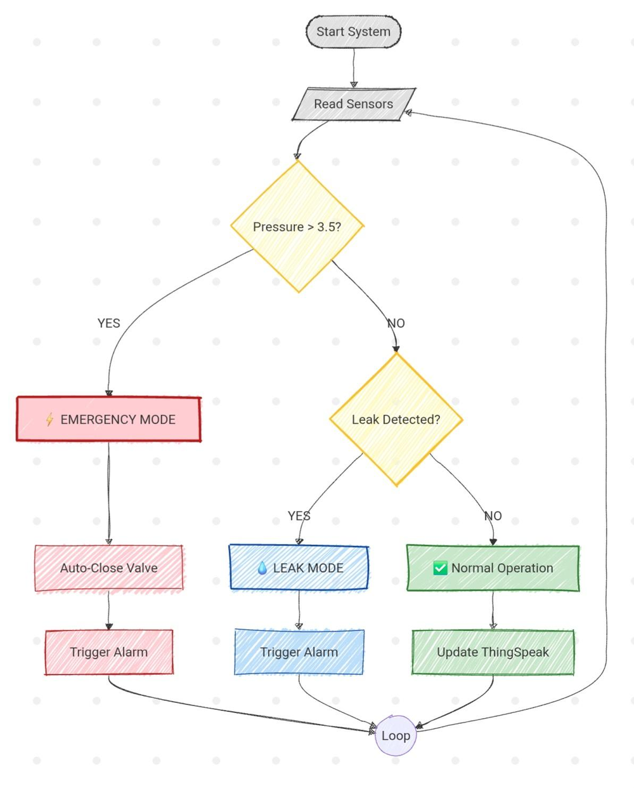

# Autonomous IoT-Based Hydraulic Monitoring and Safety Control System

<p>
  
  
  
  
</p>

An ESP32-based smart water system. It measures flow, derives hydraulic quantities (velocity, power, volume),
shows them on an OLED and on a phone-friendly web dashboard, logs them to ThingSpeak, sends e-mail alerts,
and can close a normally-closed solenoid valve automatically when its safety rules trigger.

**Why it matters:** undetected leaks and uncontrolled pressure surges are a major cause of water loss and pipe damage.
Most domestic and small-scale systems give no live visibility and no automatic fail-safe.

<p align="center">
  
  
  
</p>

<sub>The dashboard screenshots were captured with the default build, which estimates pressure with the Bernoulli model (`USE_PRESSURE_SENSOR 0`), which is why they show 6.0 bar.</sub>

## System at a glance



| Part | Details |
|---|---|
| Microcontroller | ESP32 DevKit V1: Wi-Fi, web server, ThingSpeak and SMTP from one board |
| Flow sensor | YF-S201 Hall-effect sensor, pulses counted by an interrupt on GPIO 4 |
| Pressure sensor | 0-4 bar, 4-20 mA industrial transmitter (label: *Range 0~4 bar, Power 9~36 V, Output 4~20 mA*). Its readout on GPIO 34 is an optional mode that is not yet validated on hardware (see [Pressure sensing](#pressure-sensing-4-20-ma-optional-mode)) |
| Actuator | 12 V normally-closed solenoid valve switched by a relay on GPIO 5; it closes by itself if power is lost |
| Display and feedback | 1.3" SH1106 OLED (I2C: SDA 21, SCL 22), buzzer (GPIO 19), RGB status LED (GPIO 18, 17, 16) |
| Manual controls | Valve toggle button (GPIO 13) and reset button (GPIO 12) |
| Power | Dual rail: 5 V buck converter for the relay and valve, 3.3 V LDO for the ESP32 and OLED, so solenoid back-EMF stays away from the logic |

<p align="center">
  
  
</p>



## How it works (current firmware)

The sketch runs in a single `loop()`. Once per second it updates:

| Quantity | How it is computed |
|---|---|
| Flow rate $Q$ (L/min) | pulse frequency divided by 7.5 (YF-S201 calibration) |
| Total volume | running sum of $Q/60$ every second |
| Velocity $v$ | $v = Q / A$ with $A = 1.27 \times 10^{-4}\ \mathrm{m^2}$ (1/2" pipe) |
| Pressure $P$ | Bernoulli-based estimate by default; optional 4-20 mA readout, see [Pressure sensing](#pressure-sensing-4-20-ma-optional-mode)) |
| Hydraulic power | $P_{hyd} \approx P_{[\mathrm{bar}]} \cdot Q_{[\mathrm{L/min}]} \cdot 1.666\ \mathrm{W}$ |

**Pressure.** By default (`USE_PRESSURE_SENSOR 0`) the firmware uses the Bernoulli-based estimate: a 6.0 bar assumed source pressure minus a dynamic-pressure drop,
$P = 6.0 - 1.5 \cdot \tfrac{1}{2}\rho v^2$ (converted to bar). Setting `USE_PRESSURE_SENSOR 1` switches to the 4-20 mA transmitter readout described below.

**Control modes**

1. **Manual:** the valve button toggles the valve; the reset button clears the alarm and the volume counter.
2. **Web dashboard:** the ESP32 `WebServer` serves live values at `/` and switches the valve through `/open` and `/close`. The page is reloaded manually.
3. **Autonomous rules**, checked every second:
   - **Over-pressure:** if $P$ exceeds 8.0 bar, raise the alarm, close the valve and send an e-mail.
   - **Leak:** if the valve is closed and flow exceeds 3 L/min, raise the alarm (buzzer, LED, OLED) and send an e-mail.
   - E-mails are sent once per alarm until the reset button is pressed.

**Telemetry:** every 20 s the firmware uploads five fields to ThingSpeak: pressure, flow rate, velocity, volume and valve state.

### Pressure sensing (4-20 mA, optional mode)

> **Status.** The readout is implemented from the transmitter's specification and its conversion was checked against a simulated ADC, but it has **not been validated on the rig**.
> That is why the model stays the default: the demonstration, the screenshots and the results in the report were produced with it.
> The report describes the intended design (4-20 mA sensing, 3.5 bar limit); the build documented here used the model.

The transmitter's label reads *Range 0~4 bar, Power 9~36 V, Output 4~20 mA*, so 4 mA corresponds to 0 bar and 20 mA to 4 bar:

$$P_{[\mathrm{bar}]} = \frac{I_{[\mathrm{mA}]} - 4}{16} \times 4$$

A shunt resistor between the transmitter output and ground turns the loop current into a voltage that GPIO 34 (an ADC1 pin, so it keeps working while Wi-Fi is on)
measures, $I = V / R_{shunt}$. Once per second the firmware averages 32 calibrated ADC readings and converts them to bar.
The code follows the transmitter's specification; calibrate it on your rig as described below.

```text
+12 V --> transmitter (+)
          transmitter (-) --+--> GPIO 34
                            +--[ R shunt ]--> GND        (12 V supply, shunt and ESP32 share one ground)
```

**Choosing the shunt.** The sketch assumes **120 ohm** (`PRESSURE_SHUNT_OHMS`). Set it to the value you actually fitted, measured with a multimeter.
120 ohm maps 4-20 mA to 0.48-2.40 V, comfortably inside the ADC range, and leaves at least 9.6 V for the transmitter on a 12 V loop supply (its minimum is 9 V).
Never let the voltage at GPIO 34 exceed 3.3 V.

**Fault check.** A loop current at or below 3.6 mA, or at or above 21 mA (the NAMUR NE 43 fault levels), prints a message to the Serial Monitor
(broken wire or shorted loop). The control logic is unchanged.

**Calibration**

1. If you do not know the shunt value, set `PRESSURE_DEBUG` to `1` and open the line to atmosphere (0 bar gauge). The transmitter outputs 4 mA at 0 bar,
   so the Serial Monitor line *shunt value if the line is at 0 bar* shows $R = V / 4\ \mathrm{mA}$. Round it to the nearest standard value and confirm it with a multimeter.
2. Put the confirmed value in `PRESSURE_SHUNT_OHMS`.
3. With the line at 0 bar the loop current should now read about 4.00 mA. Compare a second point with a reference gauge.

> **Over-pressure limit.** The limit is 8.0 bar in both modes, exactly as in the original code. It sits above the modelled 6.0 bar source pressure, which a 3.5 bar limit would trip immediately.
> With the transmitter enabled, lower it to the 3.5 bar used in the report (two places compare `pressureBar` with `8.0`); otherwise a 0-4 bar sensor can never reach it.



*Control logic as designed in the project report (3.5 bar limit for the 0-4 bar transmitter).*

## Getting started

**Requirements:** Arduino IDE (or PlatformIO) with the ESP32 board package, and the libraries
*U8g2* and *ESP Mail Client*. `WiFi`, `WebServer` and `HTTPClient` come with the ESP32 core.

1. Clone the repository. The folder name matches the sketch name, as the Arduino IDE requires:
   ```bash
   git clone https://github.com/abdulmlekalsharee-create/IoT-Hydraulic-Safety-Control-System.git
   ```
2. Create your credentials file and fill in your own values. **Never commit it** (`secrets.h` is in `.gitignore`):
   ```bash
   cp secrets.example.h secrets.h
   ```
3. **ThingSpeak:** create a channel with five fields (pressure, flow rate, velocity, volume, valve state) and paste its *Write API Key*.
4. **Gmail alerts:** create an [App Password](https://support.google.com/accounts/answer/185833) and use it as `SMTP_AUTHOR_PASSWORD`.
5. **Optional:** to use the 4-20 mA transmitter, wire it as shown in [Pressure sensing](#pressure-sensing-4-20-ma-optional-mode)), set `PRESSURE_SHUNT_OHMS`, set `USE_PRESSURE_SENSOR` to `1` and lower the over-pressure limit.
6. Select *ESP32 Dev Module*, upload the sketch, open the Serial Monitor at 115200 baud to read the IP address, then browse to `http://<IP>/`.

**Security notes:** keep all credentials in `secrets.h`. The `/open` and `/close` endpoints have no authentication,
so use the dashboard only on a trusted network.

## Known limitations and roadmap

- [ ] **Validate the 4-20 mA mode on the rig** (shunt calibration against a reference gauge), then make it the default.
- [ ] **Lower the over-pressure limit to 3.5 bar** together with enabling the transmitter (two places in the sketch).
- [ ] **Faster safety loop:** safety rules currently run at 1 Hz; a hardware timer or a FreeRTOS task would shorten the response time.
- [ ] **Non-blocking alerts:** e-mail and ThingSpeak calls run inside `loop()`, and the e-mail path includes a 2 s delay.
- [ ] **Authentication** for the web control endpoints.
- [ ] **Auto-refreshing dashboard** (currently a manual reload).

## Repository structure

```text
IoT-Hydraulic-Safety-Control-System/
├── IoT-Hydraulic-Safety-Control-System.ino   # ESP32 firmware
├── secrets.example.h                         # template for your private secrets.h
├── .gitignore
└── docs/
    ├── Fluid-Mechanics-Project-Report.pdf    # component selection, circuits, modelling, results
    └── images/
```

## Documentation

The [project report (PDF)](docs/Fluid-Mechanics-Project-Report.pdf) covers component selection, the dual-rail power design,
the fluid-mechanics model and test results.

## About

Individual course project for *Fluid Mechanics*, Department of Mechatronics Engineering, Faculty of Engineering,
University of Sana'a.

**Author:** Abdulmlek Al-Sharee &mdash; [@abdulmlekalsharee-create](https://github.com/abdulmlekalsharee-create)
